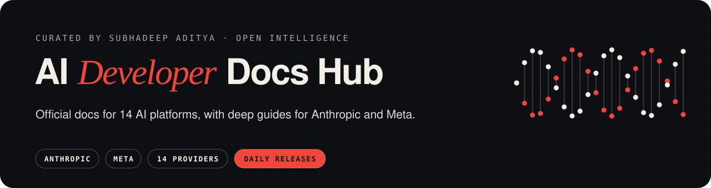
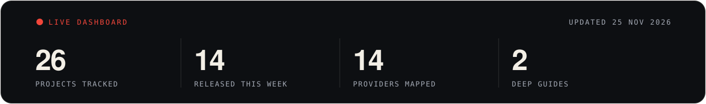

  
  
  
  

<b>The official documentation for every major AI platform — mapped, organised and kept current.</b> 
Deep guides for Anthropic and Meta · quick maps for 12 more providers · a daily tracker of new SDK and framework releases.

  <a href="anthropic/README.md"><b>Anthropic →</b></a> ·
  <a href="meta/README.md"><b>Meta →</b></a> ·
  <a href="RELEASES.md"><b>🚀 Latest releases</b></a> ·
  <a href="#-quick-map--all-providers">🗺️ All providers</a>

## 🔥 Freshest releases

The newest versions shipped across all tracked AI SDKs and frameworks — refreshed every morning (IST).

<!-- highlights:start -->
| Released | Project | Version | Provider |
|:--|:--|:--|:--|
| 2026-11-21 | [huggingface/transformers](https://github.com/huggingface/transformers) | [**v5.24.0**](https://github.com/huggingface/transformers/releases/tag/v5.24.0) | Open-source ecosystem |
| 2026-11-20 | [openai/openai-python](https://github.com/openai/openai-python) | [**v3.57.0**](https://github.com/openai/openai-python/releases/tag/v3.57.0) | OpenAI |
| 2026-11-20 | [openai/openai-agents-python](https://github.com/openai/openai-agents-python) | [**v1.0.0-alpha.1**](https://github.com/openai/openai-agents-python/releases/tag/v1.0.0-alpha.1) | OpenAI |
| 2026-11-20 | [langchain-ai/langgraph](https://github.com/langchain-ai/langgraph) | [**1.2.24**](https://github.com/langchain-ai/langgraph/releases/tag/1.2.24) | Open-source ecosystem |
| 2026-11-20 | [anthropics/claude-code](https://github.com/anthropics/claude-code) | [**v2.1.330**](https://github.com/anthropics/claude-code/releases/tag/v2.1.330) | Anthropic |
| 2026-11-20 | [anthropics/claude-agent-sdk-python](https://github.com/anthropics/claude-agent-sdk-python) | [**v0.2.187**](https://github.com/anthropics/claude-agent-sdk-python/releases/tag/v0.2.187) | Anthropic |
| 2026-11-20 | [anthropics/anthropic-sdk-typescript](https://github.com/anthropics/anthropic-sdk-typescript) | [**sdk-v1.12.0**](https://github.com/anthropics/anthropic-sdk-typescript/releases/tag/sdk-v1.12.0) | Anthropic |
| 2026-11-20 | [anthropics/anthropic-sdk-python](https://github.com/anthropics/anthropic-sdk-python) | [**v2.12.0**](https://github.com/anthropics/anthropic-sdk-python/releases/tag/v2.12.0) | Anthropic |
<!-- highlights:end -->

<a href="RELEASES.md"><b>All releases →</b></a>

---

## 📘 Deep guides

<table>
  <tr>
    <td width="50%" valign="top">
      <h3><a href="anthropic/README.md">Anthropic · Claude</a></h3>
      Claude Platform docs, API reference, prompt engineering, tool use, structured outputs, caching, Agent Skills, <b>Claude Code</b>, the <b>Agent SDK</b>, <b>MCP</b>, all SDKs, cloud options, free courses and changelogs.
    </td>
    <td width="50%" valign="top">
      <h3><a href="meta/README.md">Meta · Muse, Llama &amp; open source</a></h3>
      Meta AI developer platform, Llama docs and API, Llama Stack, PyTorch, React, FAISS, FAIR research models, and the WhatsApp, Instagram, Threads and Graph APIs.
    </td>
  </tr>
</table>

---

## 🗺️ Quick map — all providers

| Provider | Start here | Models & API | Agents & tools | Free learning |
|:--|:--|:--|:--|:--|
| **Anthropic** | [Deep guide →](anthropic/README.md) | [Claude Platform docs](https://platform.claude.com/docs) | [Claude Code](https://code.claude.com/docs) · [MCP](https://modelcontextprotocol.io) | [Anthropic Academy](https://anthropic.skilljar.com) |
| **Meta** | [Deep guide →](meta/README.md) | [Meta AI developer platform](https://developer.meta.com/ai/) · [Llama docs](https://www.llama.com/docs/overview/) | [Llama Stack](https://github.com/meta-llama/llama-stack) | [PyTorch tutorials](https://docs.pytorch.org/tutorials/) |
| **Google** | [Google AI for Developers](https://ai.google.dev) | [Gemini API](https://ai.google.dev/gemini-api/docs) · [Gemma](https://ai.google.dev/gemma) · [Vertex AI](https://cloud.google.com/vertex-ai/docs) | [Agent Development Kit](https://google.github.io/adk-docs/) | [Google AI Studio](https://aistudio.google.com) · [Colab](https://colab.research.google.com) |
| **OpenAI** | [OpenAI Platform docs](https://platform.openai.com/docs) | [API reference](https://platform.openai.com/docs/api-reference) | [Agents SDK](https://openai.github.io/openai-agents-python/) | [OpenAI Academy](https://academy.openai.com) · [Cookbook](https://cookbook.openai.com) |
| **Microsoft** | [Microsoft Learn — AI](https://learn.microsoft.com/en-us/ai/) | [Azure AI Foundry](https://learn.microsoft.com/en-us/azure/ai-foundry/) | [Semantic Kernel](https://learn.microsoft.com/en-us/semantic-kernel/) · [GitHub Copilot docs](https://docs.github.com/en/copilot) | [Microsoft Learn training](https://learn.microsoft.com/en-us/training/) |
| **Amazon (AWS)** | [AWS AI docs](https://docs.aws.amazon.com/bedrock/) | [Amazon Bedrock](https://docs.aws.amazon.com/bedrock/latest/userguide/what-is-bedrock.html) · [SageMaker](https://docs.aws.amazon.com/sagemaker/) | [Bedrock Agents](https://docs.aws.amazon.com/bedrock/latest/userguide/agents.html) | [AWS Skill Builder](https://skillbuilder.aws) |
| **NVIDIA** | [NVIDIA Developer](https://developer.nvidia.com) | [NIM / build.nvidia.com](https://build.nvidia.com) · [NeMo](https://docs.nvidia.com/nemo-framework/) | [CUDA docs](https://docs.nvidia.com/cuda/) | [Deep Learning Institute](https://www.nvidia.com/en-us/training/) |
| **xAI (SpaceX)** | [xAI docs](https://docs.x.ai) | [Grok API](https://docs.x.ai) | — | — |
| **Apple** | [Apple Developer — ML](https://developer.apple.com/machine-learning/) | [Core ML](https://developer.apple.com/documentation/coreml) · [MLX](https://github.com/ml-explore/mlx) | — | [Apple ML Research](https://machinelearning.apple.com) |
| **IBM** | [IBM watsonx docs](https://www.ibm.com/docs/en/watsonx) | [Granite models](https://huggingface.co/ibm-granite) | — | [IBM SkillsBuild](https://skillsbuild.org) |
| **Mistral AI** | [Mistral docs](https://docs.mistral.ai) | [API reference](https://docs.mistral.ai/api/) | — | — |
| **DeepSeek** | [DeepSeek API docs](https://api-docs.deepseek.com) | [Models on Hugging Face](https://huggingface.co/deepseek-ai) | — | — |
| **Hugging Face** | [Hugging Face docs](https://huggingface.co/docs) | [Transformers](https://huggingface.co/docs/transformers) · [Inference Providers](https://huggingface.co/docs/inference-providers) | [smolagents](https://huggingface.co/docs/smolagents) | [HF Learn](https://huggingface.co/learn) |
| **Qualcomm** | [Qualcomm AI Hub](https://aihub.qualcomm.com) | On-device model zoo | — | — |

---

## 🚀 Release tracker

[`RELEASES.md`](RELEASES.md) is rebuilt every morning from the GitHub API with the newest versions of:
Anthropic SDKs, Claude Code, the Agent SDK and MCP SDKs · Llama models and Llama Stack · PyTorch · React · FAISS · Google GenAI SDK and ADK · JAX · TensorFlow · Semantic Kernel · AutoGen · VS Code · OpenAI SDKs · NVIDIA NeMo and TensorRT-LLM · Transformers · LangGraph · Ollama · vLLM.

---

## 🔗 Part of the Open Knowledge series

| Learn | Track |
|:--|:--|
| [Awesome Biotechnology](https://github.com/Subhadeep998/Awesome-Biotechnology) · [Awesome AI Learning](https://github.com/Subhadeep998/Awesome-AI-Learning) · [Open Biology Handbook](https://github.com/Subhadeep998/Open-Biology-Handbook) | [Science Research Radar](https://github.com/Subhadeep998/Science-Research-Radar) · [Global Company Radar](https://github.com/Subhadeep998/Global-Company-Radar) · [Law Firm Radar](https://github.com/Subhadeep998/Law-Firm-Radar) · **AI Developer Docs Hub** |

  ⭐ <b>Star</b> to bookmark · 👤 <a href="https://github.com/Subhadeep998"><b>Follow @Subhadeep998</b></a> 
  Curated by <a href="https://subhadeep998.github.io">Subhadeep Aditya</a> · Unofficial index — not affiliated with any provider listed · Links to official sources only

