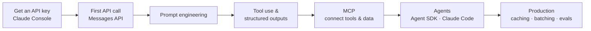

# Anthropic — Developer Documentation Map

[← Back to the hub](../README.md) · [All releases](../RELEASES.md)

> Everything you need to build with Claude, in one page — organised from first API call to production agents.
> Links point to **official Anthropic sources only**. Docs move fast: when in doubt, start at the [Claude Platform docs home](https://platform.claude.com/docs).

---

## 🚀 Latest releases (auto-updated daily)

<!-- releases:start -->
_Release data fills on the next daily run._
<!-- releases:end -->

**Official changelogs** — [Claude Platform release notes](https://platform.claude.com/docs/en/release-notes/overview) · [Claude Code CHANGELOG](https://github.com/anthropics/claude-code/blob/main/CHANGELOG.md) · [Claude apps release notes](https://support.claude.com/en/articles/12138966-release-notes)

---

## 🗺️ Learning path

---

## 1 · Start here

| Resource | What it's for |
|:--|:--|
| [Claude Platform docs](https://platform.claude.com/docs) | The home of all developer documentation |
| [Claude Console](https://platform.claude.com) | API keys, usage, billing and the prompt workbench |
| [API reference](https://platform.claude.com/docs/en/api/overview) | Endpoints, parameters and errors |
| [Models overview](https://platform.claude.com/docs/en/about-claude/models/overview) | Current models, context windows and choosing one |
| [Pricing](https://platform.claude.com/docs/en/about-claude/pricing) | Per-token prices, caching and batch discounts |

## 2 · Build with Claude

| Topic | Docs |
|:--|:--|
| Prompt engineering | [Overview and techniques](https://platform.claude.com/docs/en/build-with-claude/prompt-engineering/overview) |
| Tool use (function calling) | [Tool use guide](https://platform.claude.com/docs/en/agents-and-tools/tool-use/overview) |
| Structured outputs | [Structured outputs](https://platform.claude.com/docs/en/build-with-claude/structured-outputs) |
| Prompt caching | [Prompt caching](https://platform.claude.com/docs/en/build-with-claude/prompt-caching) |
| Batch processing | [Message Batches](https://platform.claude.com/docs/en/build-with-claude/batch-processing) |
| Vision & PDFs | [Vision](https://platform.claude.com/docs/en/build-with-claude/vision) · [PDF support](https://platform.claude.com/docs/en/build-with-claude/pdf-support) |
| Extended thinking | [Extended thinking](https://platform.claude.com/docs/en/build-with-claude/extended-thinking) |
| Citations | [Citations](https://platform.claude.com/docs/en/build-with-claude/citations) |
| Agent Skills | [Agent Skills overview](https://platform.claude.com/docs/en/agents-and-tools/agent-skills/overview) |

## 3 · Agents & tools

| Topic | Docs |
|:--|:--|
| **Claude Code** — agentic coding in your terminal and IDE | [Claude Code docs](https://code.claude.com/docs) · [GitHub](https://github.com/anthropics/claude-code) |
| **Claude Agent SDK** — build your own agents on the Claude Code harness | [Agent SDK overview](https://code.claude.com/docs/en/agent-sdk/overview) |
| **Model Context Protocol (MCP)** — the open standard for connecting AI to tools and data | [modelcontextprotocol.io](https://modelcontextprotocol.io) · [Reference servers](https://github.com/modelcontextprotocol/servers) |
| Server tools (web search, web fetch, code execution) | [Tool use → server tools](https://platform.claude.com/docs/en/agents-and-tools/tool-use/overview) |
| Building effective agents — design patterns | [Anthropic Engineering](https://www.anthropic.com/engineering/building-effective-agents) |

## 4 · SDKs

| Language | Repository |
|:--|:--|
| Python | [anthropics/anthropic-sdk-python](https://github.com/anthropics/anthropic-sdk-python) |
| TypeScript / JavaScript | [anthropics/anthropic-sdk-typescript](https://github.com/anthropics/anthropic-sdk-typescript) |
| Java | [anthropics/anthropic-sdk-java](https://github.com/anthropics/anthropic-sdk-java) |
| Go | [anthropics/anthropic-sdk-go](https://github.com/anthropics/anthropic-sdk-go) |
| Agent SDK (Python) | [anthropics/claude-agent-sdk-python](https://github.com/anthropics/claude-agent-sdk-python) |

## 5 · Run Claude in the cloud you already use

[Claude on AWS](https://platform.claude.com/docs/en/build-with-claude/claude-platform-on-aws) · [Claude on Google Cloud](https://platform.claude.com/docs/en/build-with-claude/claude-on-vertex-ai) · [Claude in Microsoft Foundry](https://platform.claude.com/docs/en/build-with-claude/claude-in-microsoft-foundry)

## 6 · Learn for free

| Resource | Format |
|:--|:--|
| [Anthropic Academy](https://anthropic.skilljar.com) | Self-paced courses with certificates (AI Fluency, Claude Code, API) |
| [Anthropic courses on GitHub](https://github.com/anthropics/courses) | Notebooks: API fundamentals, prompt engineering, tool use, evals |
| [Interactive prompt-engineering tutorial](https://github.com/anthropics/prompt-eng-interactive-tutorial) | Hands-on exercises |
| [Claude Cookbooks](https://github.com/anthropics/claude-cookbooks) | Copy-paste recipes: RAG, tool use, multimodal, agents |
| [Anthropic Engineering blog](https://www.anthropic.com/engineering) | How Anthropic builds with Claude |

## 7 · Research, safety & policy

[Research](https://www.anthropic.com/research) · [Transparency hub](https://www.anthropic.com/transparency) · [Responsible Scaling Policy](https://www.anthropic.com/responsible-scaling-policy) · [Usage policy](https://www.anthropic.com/legal/aup)

## 8 · Support & status

[Help Center](https://support.claude.com) · [API status](https://status.claude.com) · [Discord community](https://www.anthropic.com/discord)

---
Unofficial index curated by <a href="https://github.com/Subhadeep998">@Subhadeep998</a>. Not affiliated with Anthropic. Spotted a moved link? <a href="../../../issues">Open an issue</a>.
